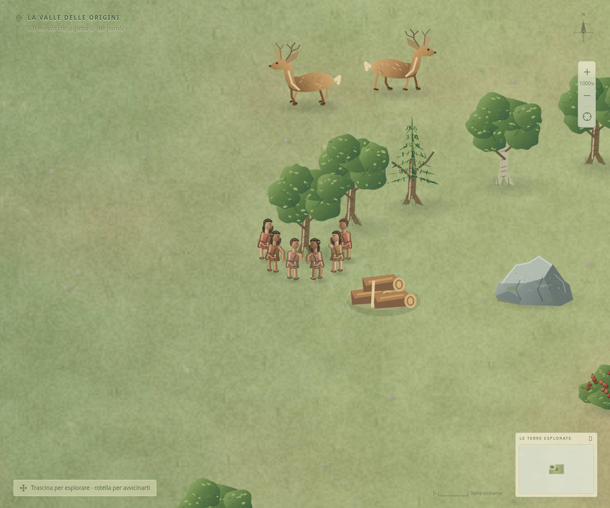

# Azioni, movimento e posti di lavoro

La revisione collega le pose alle azioni effettive e distribuisce le persone attorno al bersaglio. I posti sono coordinate reali della simulazione: distanze, esposizione al freddo, materiali e consegne continuano a usare la posizione della persona.

La scena di verifica usa i sette membri iniziali e un ordine reale di gruppo; i sei adulti lavorano e il bambino resta escluso. La parola Legno è già conosciuta per mantenere visibile il lavoro senza interromperlo con il puzzle. Prima della revisione i sei lavoratori finivano nello stesso punto; dopo dodici secondi di questa prova la distanza minima fra loro è circa 1,28 m. Legna estratta e legna ancora nell'albero conservano il totale iniziale; le scorte aumentano soltanto dopo un trasporto.

## Posizioni

- Alberi, rocce e raccolta hanno posti davanti e sui fianchi della fonte. La posizione di un lavoratore rimane stabile quando un compagno finisce o muore.
- Addetti e guardiani si dispongono attorno all'edificio, entro i tre metri richiesti dal conteggio del lavoro. Nessuno deve stare nel centro del Falò.
- Cacciatori e combattenti si distribuiscono entro la portata effettiva dell'arma. Il disegno non concede attacchi a distanza maggiore.
- Rientri, scarico e giacigli hanno posti distinti nel campo, entro il raggio reale delle scorte e del riposo. Il Tabù delle Tenebre conserva il suo limite più stretto.
- Costruzioni e alberi piantati nascono nel punto ordinato; i piedi dell'esecutore rimangono a lato. I frammenti estratti si accumulano presso la fonte; un carico interrotto cade dove si trova il trasportatore.
- Scheggiare conserva il punto da cui vengono pagati i materiali entro 15 m. Un ordine di gruppo sceglie un artigiano selezionato che abbia davvero gli ingredienti a portata.

I percorsi restano diretti. La distribuzione evita l'arrivo collettivo su una sola coordinata; durante un incrocio o un combattimento affollato sono ancora possibili sovrapposizioni temporanee. Non vengono introdotti ostacoli solidi, limiti nuovi di produzione o code che blocchino la tribù.

## Animazioni

Cammino, fuga, carico, taglio, estrazione, raccolta, scheggiatura, costruzione, affondo, colpo, pasto, semina, fusione, scrittura, insegnamento, culto e cura degli animali hanno pose distinte. Le braccia, l'oggetto impugnato e il carico condividono presa e orientamento; neonati e dormienti conservano la propria rappresentazione. Pasti e consegne reali producono brevi gesti visibili, senza aggiungere un altro costo o un'attesa al compito.

Il passo dipende dallo spostamento osservato. L'avvicinamento ha priorità sul gesto di lavoro; la posa operativa richiede che l'esecutore sia arrivato e abbia iniziato il lavoro. I campioni della simulazione, aggiornati ogni 250 ms, vengono interpolati nel renderer. La selezione segue la posizione disegnata e restituisce il bersaglio reale.

Cervi, lupi, predatori alfa e mammut hanno arti e teste articolati: pascolo e allerta, fuga, corsa, morso, reazione alla ferita e passo pesante sono collegati a movimento e danni effettivi. La presenza permanente del flag `attacked` non basta a simulare un nuovo morso. Le carcasse restano ferme.

Il clock delle pose è continuo e rispetta la velocità del gioco; la pausa congela il canvas. La cronologia del disegno appartiene alla singola mappa e si azzera quando il tempo torna indietro. Nessuna cronologia grafica entra nel salvataggio.

## Verifiche

Esito della revisione: **794 test del motore e dei componenti e 53 casi browser superati**, con build e formattazione valide.

Le prove del motore coprono portata, stabilità dei posti, giacigli, pagamento locale, conservazione dei carichi e ancore di costruzione. Le prove delle pose controllano movimento reale, presa degli strumenti, pausa e ferite degli animali. `tests/staging.spec.ts` esegue l'ordine di gruppo nel browser su desktop e mobile e confronta i pixel durante la pausa. Le rotte dei primi anni vengono riprovate con ordini pubblici e materiali reali, aggiornando i tragitti per le nuove posizioni.

`tests/motion-selection.spec.ts` controlla un fotogramma intermedio senza attese legate alla velocità della macchina: il clic cade sulla testa disegnata e restituisce la posizione reale della persona. La stessa prova fallisce se si disabilita la selezione sulla posizione interpolata.

Una verifica tecnica in Chromium headless con 150 persone e 456 elementi ha misurato mediane di circa 12–20 ms per l'invio del disegno al canvas dopo il riscaldamento delle cache, fra zoom 100% e 1600%. Il mondo resta identico prima e dopo il rendering. Sono misure tecniche su uno stato di carico preparato, non una garanzia di frame rate sui telefoni.
