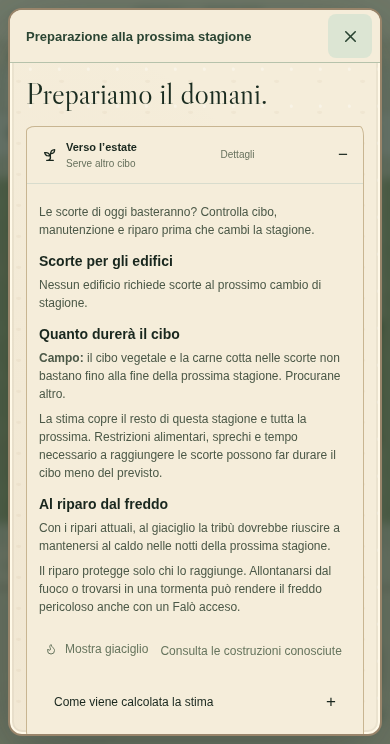

# Revisione editoriale italiana

La revisione parte dal pannello di preparazione stagionale segnalato dal giocatore e comprende tutorial, guida iniziale, composizione delle frasi, descrizioni e indizi del lessico, costruzioni, insegnamento, bisogni della tribù, eventi, diplomazia, dogmi, leggi, città, vittorie e salvataggi. Sono stati rivisti circa trecento passaggi; i testi già chiari sono conservati.

## Voce del gioco

Le istruzioni si rivolgono al giocatore con verbi diretti: scegli, indica, prepara, pronuncia. Gli indizi delle Scintille mantengono una voce evocativa legata all’esperienza della tribù. La Cronaca racconta ciò che è accaduto, senza trasformare eventi possibili in risultati garantiti.

Un avviso deve spiegare il problema e, quando possibile, indicare un’azione utile. Le spiegazioni dei calcoli vengono dopo il risultato. I pannelli descrivono il mondo e le sue regole; informazioni sul documento di progetto, decisioni tecniche e formule di implementazione restano nella documentazione.

## Lessico coerente

| Termine        | Uso                                                                                                               |
| -------------- | ----------------------------------------------------------------------------------------------------------------- |
| Giaciglio      | Il luogo a cui torna la tribù per riposare. Campo e accampamento indicano l’area che lo circonda.                 |
| Scorte         | Risorse consegnate e disponibili al campo o in città. Un cumulo a terra non è ancora nelle scorte.                |
| Legno          | Nome della risorsa nei costi. Nelle frasi si scrive «cinque unità di legno», non «cinque legna».                  |
| Ordine diretto | Il comando impartito con Pronuncia, distinto da un incarico permanente o da una legge.                            |
| Incarico       | Il lavoro assegnato a un edificio, che può essere sospeso e riprendere nel turno previsto.                        |
| Scintilla      | Un’intuizione da aprire e comprendere. L’esperienza può farla nascere; non equivale da sola a una parola appresa. |
| Custode        | Una persona che mantiene viva una parola. L’etichetta concorda con la persona: «Ultima custode» per Uma.          |
| Memoria        | Quanto una parola è ancora salda. Formare un altro custode e rafforzare la memoria sono effetti distinti.         |
| Attenzione     | La risorsa spesa per insegnare o ripassare al Falò. Le quantità si esprimono in punti.                            |
| Voce           | La risorsa degli ordini diretti. La selezione e la preparazione della frase non la consumano.                     |

Gli esempi di frase usano il separatore «·». Il segno «+» resta ai bonus. Nomi delle parole, identificativi, ricette, costi e parametri della simulazione sono conservati.

## Correzioni di significato

| Prima                                                                                             | Revisione                                                                                                                                                    |
| ------------------------------------------------------------------------------------------------- | ------------------------------------------------------------------------------------------------------------------------------------------------------------ |
| «Verso Estate»                                                                                    | «Verso l’estate», con articolo adatto a tutte e quattro le stagioni.                                                                                         |
| «Le sole scorte non crude non offrono margine…»                                                   | La stima nomina cibo vegetale e carne cotta, chiarisce se bastano e invita a procurare altro cibo quando serve.                                              |
| «Prossima notte stagionale» e «raggi reali»                                                       | Notti della prossima stagione e necessità di raggiungere il riparo; una tormenta o la distanza dal fuoco possono rendere il freddo pericoloso.               |
| Una lunga introduzione al calcolo delle scorte                                                    | Un risultato leggibile subito; «Come viene calcolata la stima» conserva ipotesi e limiti in una sezione espandibile.                                         |
| Il Falò «chiama tutta la tribù» nella descrizione di Gruppo                                       | Gruppo si rivolge alla selezione attuale; Tutti gli adulti include chi è lontano.                                                                            |
| Scoperta di Qui descritta sempre come due notti, Fuoco solo come fulmine, Io solo come isolamento | Descrizioni generali compatibili con i percorsi disponibili. La guida specifica le differenze fra Guidata e Classica.                                        |
| Portare descritto soltanto come raccolta                                                          | È chiarito che può estrarre da alberi e rocce e trasportare, mentre non abbatte animali vivi. Colpire lascia invece i materiali a terra.                     |
| «Uma è morto. La sua memoria appartiene ora alla tribù.»                                          | Accordo corretto e nessuna promessa di trasmissione automatica: la perdita della persona e quella delle parole vengono spiegate separatamente.               |
| «1 custodi», «1 persone»                                                                          | Accordi al singolare nelle lezioni, nel lessico e negli avvisi; sono riviste anche vita, anime e stagioni.                                                   |
| Nessun allievo disponibile interpretato come parola già nota a tutti                              | Il messaggio spiega che serve un compagno abbastanza giovane che non conosca già la parola; disponibilità di nuovi custodi e memoria piena restano distinte. |
| «Vettore dogmatico», «archetipo», «output», «oblio γ=0,5»                                         | Regola del dogma, effetti sulla produzione e spiegazione della perdita naturale di memoria. Il bonus additivo alle nascite è espresso in punti percentuali.  |
| Parametri di conformità nel lessico del gioco                                                     | Indicazioni su esperienza, custodi e scrittura; la conformità resta nei documenti del progetto.                                                              |

Gli ordini notturni pronunciati di giorno chiedono di riprovare dopo il tramonto: non promettono un’esecuzione automatica. Nei dettagli della preparazione stagionale, il cibo già consegnato è distinto dal legno a terra vicino ai falò, che può contribuire alla loro manutenzione.

## Verifica

Il confronto strutturale dei file del motore conferma modifiche ai testi, non a numeri, ricette o formule. Le poche espressioni di presentazione aggiunte gestiscono l’accordo del messaggio di morte, l’ordine dei concetti nelle descrizioni dei dogmi e il nome del carico trasportato.

Sono verificate le 1.098 prove unitarie e integrate e i 131 casi del browser, con ripetizioni mirate dopo l’aggiornamento delle attese testuali. Rimangono le asserzioni su costi, inventari, nuovi custodi, parole sconosciute, quantità nascoste prima di Numero, nomi prima di Io, gesti e azioni effettive. Una descrizione dei cumuli è stata corretta durante questa verifica per non nominare Portare prima della sua scoperta.

Il pannello segnalato è stato osservato in Chromium a 390 × 744 e su desktop, anche con la spiegazione del calcolo aperta. Le prove con stati preparati verificano testi e interazioni, non il bilanciamento di una campagna intera; l’emulazione mobile non certifica ogni telefono fisico.

