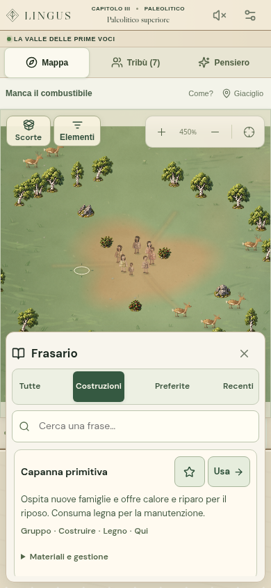
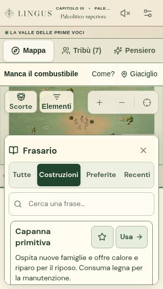

# Frasario e costruzioni

## Accesso durante la partita

Accanto ai comandi sono sempre disponibili **Frasi** e **Costruisci**, anche a
parole chiuse sul cellulare. Il primo apre il frasario; il secondo porta
direttamente alle costruzioni note. Le schede spiegano l’utilità degli edifici
anche prima di Numero e permettono di consultare materiali e gestione.

Il frasario offre ricerca, categorie, preferite e recenti. La stella conserva
una frase da ritrovare; **Salva la frase composta** permette di annotare anche
una preparazione valida ancora mai eseguita. **Usa** riempie il compositore e
chiude il pannello. La vecchia destinazione viene liberata: si può scegliere il
bersaglio nel mondo attuale prima di Pronuncia.

Sul telefono verticale il pannello occupa la parte bassa dello schermo mentre
si consulta il registro, lasciando visibile la valle. In orizzontale si dispone
su un lato. Non c’è un fondale che blocca la mappa; un tocco sul mondo chiude
il pannello. Escape chiude il frasario senza cancellare la frase già composta.

## Persistenza e regole

Il frasario è una memoria del giocatore salvata insieme alla partita. Registra
le frasi dopo che il gestore degli ordini le ha accettate e permette di segnare
come preferite anche ricette note ma mai utilizzate. Una preferita non inventa
una prima esecuzione: le date di utilizzo compaiono soltanto dopo un ordine
accettato. Le anteprime e i tentativi respinti non devono essere registrati.

Il catalogo comprende le ricette edilizie e alcune azioni ordinarie soltanto
quando tutte le parole sono note. Le frasi già annotate restano consultabili
anche quando una parola viene perduta: il registro indica quale concetto
riscoprire e impedisce il richiamo finché mancano conoscenze o spazi di pensiero.
Non aumenta la ritenzione, non assegna custodi e non anticipa Scrittura.

Richiamare una frase prepara i tasselli. Non spende Voce, materiali o
Attenzione, non muove persone e non esegue l’ordine. Non sono conservati
bersagli, coordinate o identificatori degli esecutori: selezione e destinazione
vanno verificate nel mondo corrente, prima di **Pronuncia**.

Le descrizioni degli edifici spiegano sempre la loro utilità concreta, anche
prima di Numero. Le quantità restano soggette alla normale presentazione
cognitiva. La frase del Falò è **Gruppo · Conservare · Fuoco**, utilizzabile per
la prima accensione con materiali sufficienti e per alimentare il fuoco; il solo
token Fuoco del catalogo non viene presentato come un ordine grammaticale.
Coltivazione, allevamento e fonderie distinguono la creazione della struttura
dall’assegnazione degli addetti quando viene indicato un edificio già esistente.

Il registro distingue inoltre i comandi imperiali dai lavori ordinari: convogli,
doni diplomatici, delegazioni, reclutamento, cavalleria e attacco agli
insediamenti hanno spiegazioni proprie. La costruzione urbana di case con
Città è un quartiere di più abitazioni; il costo deriva dalla ricetta risolta,
compreso il suo moltiplicatore, e non da quello della singola casa.

Sono conservate al massimo sessantaquattro annotazioni. I preferiti vengono
preservati prima delle voci ordinarie più vecchie; se tutti i posti sono
preferiti, occorre togliere una stella prima di aggiungerne un altro. La lettura
del catalogo non crea annotazioni nello stato. Il registro non consuma RNG,
tempo simulato, identificatori degli eventi o risorse.

I salvataggi precedenti, privi del campo facoltativo `phrasebook`, restano
validi. L’importazione controlla limite, unicità, identità della frase,
vocabolario effettivamente presente nella storia e date non future. Il campo
non accetta bersagli o proprietà arbitrarie.

## Verifica del modello

`phrasebook.test.ts` verifica catalogo e oscuramento del futuro, descrizioni
qualitative, richiamo dopo oblio, date effettive e prima esecuzione a tempo
zero, preferiti, limite del registro, importazione e salvataggi precedenti. Le
prove usano anche un ordine pubblico accettato, senza alterarne costi, RNG,
lavoratori o tempo. I casi sui dogmi seguono il compilatore reale, compresi i
vettori espressi da un verbo; le frasi urbane rispettano quantità e costi della
costruzione multipla. Non sono prove di una campagna completa.

## Interfaccia verificata

La verifica del deploy ha successivamente rilevato una regressione: selezionare
un bersaglio aggiungeva una seconda riga alla barra mobile, portando il
compositore a 200 px. La barra ora mantiene una sola riga: il nome della
destinazione resta sulla mappa, mentre vicino ai comandi rimangono lo stato
accessibile e il pulsante di rimozione da 44 px. Non sono stati allentati i
limiti del test: 180 px sul telefono verticale e 140 px in orizzontale.

Quattro casi aggiuntivi verificano la selezione e rimozione del bersaglio con
testo grande a 320 × 568, 384 × 720, 390 × 844 e 844 × 390: nessuna riga
aggiunta, pulsanti raggiungibili, Voce leggibile e nessun ordine eseguito per
la sola selezione. Anche la prova della build sotto `/Lingus/` apre Frasi e
Costruisci e controlla l’altezza dopo la selezione. In caso di nuovi errori,
la pipeline conserva immagini e tracce del browser per sette giorni.

Dopo la correzione è stato ripetuto l’intero gruppo usato dal deploy, con un
solo worker: **76 casi superati**, incluso il test 39 segnalato da GitHub.
È passato anche il controllo dell’artefatto di produzione sotto `/Lingus/`.

La revisione passa **1.408 test unitari in 108 file**. Il gruppo browser su
frasario, composizione mobile, assistente sintattico, anteprime e costruzioni
pagate passa **38 casi**. Il frasario è stato esercitato a 320 × 568,
390 × 844, 844 × 390 e 1440 × 1050, includendo testo grande e contrasto elevato
sul telefono più piccolo. Sono state osservate anche le immagini prodotte dal
browser effettivo.

Le prove coprono accesso diretto alle costruzioni, utilità prima di Numero,
parole future nascoste, preparazione senza pagamenti, preferite dopo ricarica,
esportazione e importazione reali, rimozione delle preferite perdute,
annotazione di una frase non ancora eseguita e mancata registrazione degli
ordini rifiutati. Il richiamo libera il vecchio bersaglio; Escape conserva la
composizione. La lista rimane consultabile anche in orizzontale senza
intercettare i tocchi destinati a Pronuncia.

