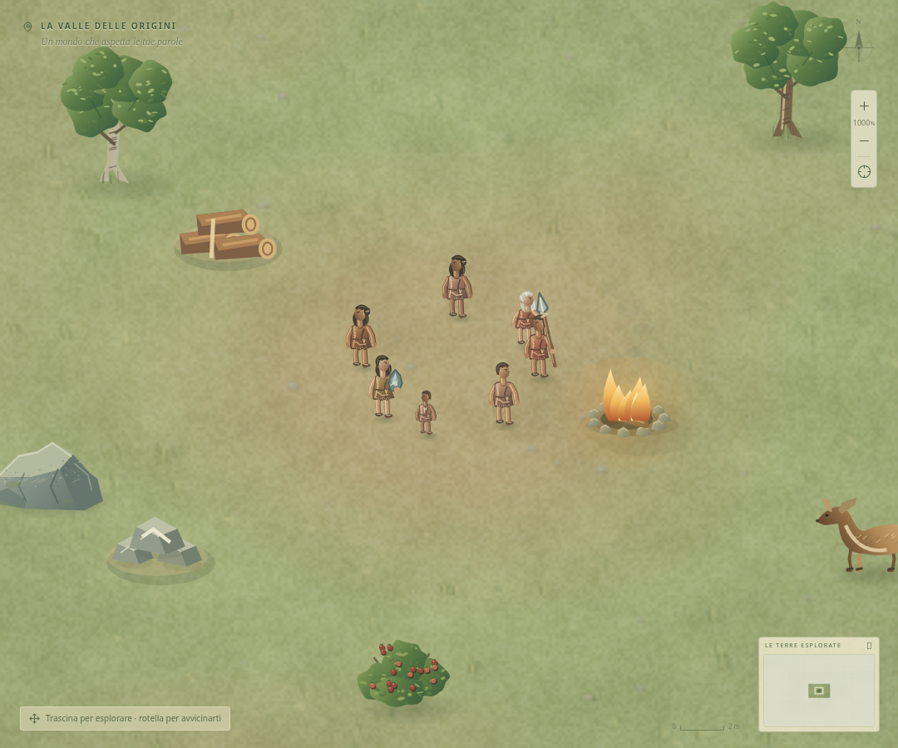

# Revisione grafica della valle

La direzione scelta è **2D pittorico e naturale**. Il renderer Canvas usa disegni originali nel codice: terreno con velature e pigmento fine, vegetazione irregolare, materiali riconoscibili e una luce calda coerente. Non richiede immagini o servizi esterni.

Questa immagine è una scena di verifica con materiali conosciuti, strumenti assegnati e Falò acceso. Serve a confrontare lo stesso luogo e lo stesso zoom con il renderer precedente; non documenta una campagna giocata fino a questo punto.

## Copertura

- **Terreno:** superfici per i quattro biomi, radura consumata irregolare, erba minuta, variazioni stagionali, rive e acqua allineate alla geografia reale. Il disegno usa il seed originale della mappa e rimane stabile durante la simulazione.
- **Natura:** tronchi ramificati, chiome variate, cespugli con frutti, selce fratturata, minerale, germogli, cervi, lupi, predatori alfa e mammut. Ceppi, affioramenti esauriti e carcasse hanno sagome distinte. I materiali non ancora conosciuti conservano la rappresentazione neutra.
- **Persone:** volti, capelli, pelle, cuciture e pieghe delle vesti; neonati avvolti, bambini più piccoli, anziani ingrigiti e leggermente curvi. Passo, lavoro e sonno cambiano la posa. Gli strumenti restano legati all'equipaggiamento effettivo; la presa non si sposta quando viene ridimensionato l'oggetto.
- **Edifici:** tutti i venti tipi hanno legno, paglia o pietra coerenti, aperture in ombra e particolari che ne indicano la funzione. Il Falò spento mostra la cenere; fiamme e fumo richiedono un edificio acceso. Cantieri, danni e inattività rimangono visibili.
- **Mappa strategica:** i battaglioni hanno figure, insegne e le eventuali cavalleria e catapulta reali; le carovane distinguono commercio, tributi, coloni e saggi. I carichi disegnati dipendono dalle merci presenti.
- **Leggibilità:** nascita, ultimo Custode, pericolo e carico restano segnalati. I raggi del gruppo e del giaciglio appaiono durante la selezione; le linee rimangono sottili allo zoom elevato. L'area effettiva del calore compare selezionando il Falò acceso.

La grafica conserva coordinate, quantità, lavoro, regole e salvataggi. La vegetazione decorativa minuta non rappresenta nuovi nodi raccoglibili. Le sagome cliccabili seguono lo zoom: si possono selezionare anche la testa di una persona, la chioma di un albero e il tetto di una capanna, mantenendo distinti fonte e materiale caduto.

## Verifica e costo del disegno

`tests/visual-map.spec.ts` esercita queste selezioni reali in Chromium a 1000% e 1600%, su desktop e su schermo largo 390 px. Le altre prove browser continuano a verificare ordini, risorse, custodi e interfaccia. Le scene comparative a 580% e 1000%, comprese catture mobili a DPR 2, non hanno prodotto errori JavaScript.

Verifica della revisione: **769 test del motore/componenti e 50 test browser superati**, build TypeScript/Vite e formattazione valide. Dopo l'integrazione delle icone strategiche sono stati ripetuti anche i nove casi browser pertinenti alla mappa, al mobile e all'era urbana.

Il terreno viene preparato una volta per stagione o cambiamento della geografia. Le varianti naturali usano una cache LRU limitata a 128 immagini; gli edifici memorizzano al massimo venti disegni statici. Il renderer scarta gli oggetti fuori dalla visuale lasciando margine per chiome e fumo, mentre animazioni e notte seguono il tempo del gioco e si fermano in pausa.

Nella prima revisione grafica, una misura tecnica in Chromium headless, con una mappa interamente rivelata da 456 elementi e 150 abitanti sintetici, ha registrato mediane di circa 11–17 ms per l'invio del disegno al canvas dopo il riscaldamento delle cache. È una prova di carico preparata, non una campagna né una garanzia di frame rate sui telefoni. La rifinitura per una pubblicazione richiede ancora prove prolungate su dispositivi reali, giudizio artistico sull'intera partita e verifica dell'accessibilità visiva.

## Organizzazione

[ANIMATION.md](ANIMATION.md) documenta la successiva revisione delle pose, dell'interpolazione e dei posti di lavoro fisici.

[UI-ATMOSPHERE.md](UI-ATMOSPHERE.md) descrive i materiali dei pannelli nelle sei ere e gli effetti atmosferici collegati alla simulazione.

`mapTerrainArt.ts`, `mapNatureArt.ts`, `mapPeopleArt.ts`, `mapBuildingArt.ts` e `mapStrategicArt.ts` contengono i disegni. `mapDrawing.ts` mantiene composizione della scena, visibilità, selezioni e indicatori; `WorldMap.tsx` gestisce camera e interazione. Questa separazione permette di rifinire l'arte senza cambiare la simulazione.
