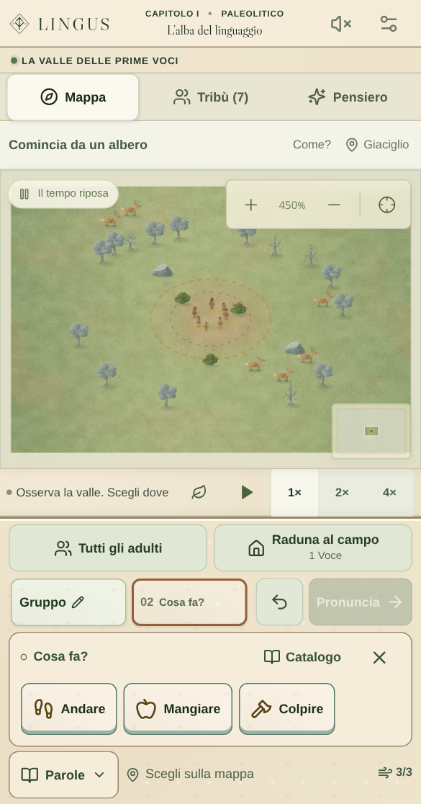

# Comporre senza perdere di vista il mondo

Lo screenshot del giocatore ha rivelato un difetto rimasto dopo la revisione delle schermate: il banco imponeva un’altezza fino a 350 px anche quando «Gruppo · Andare» aveva già riempito tutti gli spazi disponibili. Toolbar, footer e contenitore elastico restavano aperti, con poche informazioni utili e molta mappa coperta.

## Flusso aggiornato

**Parole** e gli spazi della frase aprono la palette contestuale, alta 106 px compresi i bordi nella scena iniziale osservata. Il titolo indica lo spazio attivo. La riga propone solo parole vive che possono completare il prefisso; una freccia e lo scorrimento permettono di raggiungere tutte le continuazioni. Lo spazio attivo ha un contorno visibile. I due spazi iniziali entrano entrambi anche a 360 px, senza tagliare il soggetto.

In verticale la palette partecipa al layout: il Canvas riceve lo spazio rimasto e non viene coperto da un editor. In orizzontale i suggerimenti occupano il lato destro, lasciando libera la parte sinistra della mappa. Il bersaglio può essere selezionato durante la composizione, conservando frase e parola in modifica. Non occorre un passaggio obbligatorio attraverso «Scegli il bersaglio».

Quando una scelta dalla palette completa la grammatica e non esistono altre continuazioni, i suggerimenti si chiudono. «Gruppo · Andare» al primo capitolo torna quindi subito alla mappa. La sola validità grammaticale non basta a chiudere: i dettagli di Caccia Grossa e le continuazioni delle leggi restano disponibili. La grammatica completa non garantisce la presenza di bersaglio, materiali o Voce; l’anteprima continua a verificare l’esecuzione reale.

**Catalogo** è un’espansione esplicita, con ricerca immediata, filtri e tutte le parole già scoperte. I concetti perduti rimangono disabilitati. **Torna ai suggerimenti** riduce l’editor senza perdere la frase; la chiusura e la ricerca restano raggiungibili nel viewport ridotto che simula la tastiera. I comandi vicini e le frasi recenti stanno in **Persone e ordini** nel catalogo. Sul desktop rimane il banco esteso.

Pronuncia conserva la frase e il bersaglio per ordini successivi. Apertura, ricerca, sostituzione, annullamento e selezione non impartiscono ordini. I test verificano l’addebito reale soltanto quando si pronuncia. È corretto anche il caso modifica dell’ultima parola → annullamento → nuova scelta: il tocco aggiunge di nuovo la parola anziché perdersi su uno spazio ormai inesistente.

## Osservazione e prove

Le misure seguenti provengono dalla scena iniziale Guidata, Seed Zero, ferma e senza altri avvisi. Sono pixel CSS dello spazio effettivamente disponibile al sito, esclusa l’interfaccia del browser:

| Viewport  | Altezza mappa durante la scelta | Altezza palette | Posizione                                             |
| --------- | ------------------------------: | --------------: | ----------------------------------------------------- |
| 360 × 640 |                          173 px |          106 px | Nel layout, sotto la frase                            |
| 390 × 744 |                          277 px |          106 px | Nel layout, sotto la frase                            |
| 844 × 390 |                          149 px |          106 px | Laterale, larga 360 px; oltre metà mappa resta libera |

La chiusura restituisce circa 110 px alla mappa verticale; in orizzontale la mappa conserva la stessa altezza. Altri avvisi possono cambiare lo spazio disponibile: queste misure non sono promesse per ogni stato della partita.

`tests/mobile-composer-flow.spec.ts` aggiunge dieci prove sull’App reale con touch: mappa effettivamente raggiunta tramite `elementFromPoint`, composizione su tre viewport, chiusura terminale senza pannello vuoto, due ordini consecutivi con costo Voce reale, dettagli facoltativi, legge a sei parole, sostituzione con coda conservata, annullamento durante la modifica e ricerca con tastiera simulata. Un caso verifica anche il cambio contemporaneo di larghezza e altezza con la ricerca attiva: i risultati rimangono raggiungibili senza dipendere dal rilevamento della tastiera. Gli stati avanzati sono preparati dichiarati, non campagne ordinarie. Le prove del layout precedente sono adattate al nuovo flusso mantenendo costi, soglie e controlli sul tocco.

La suite entra nel controllo Pages prima della pubblicazione. La verifica locale comprende 56 test dei componenti, build, formattazione e 131 casi browser, con esecuzione completa e ripetizione mirata dopo le ultime correzioni. L’emulazione Chromium non sostituisce prove su telefoni fisici e Safari.

