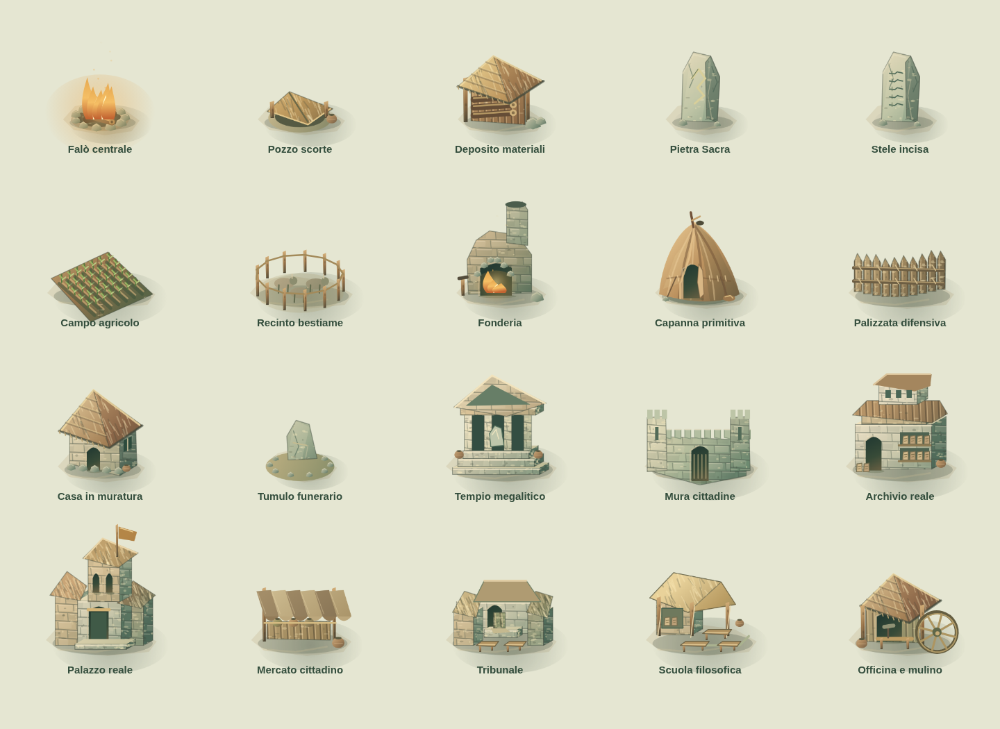

# Consolidamento del gioco — versione 0.3

Questa revisione affronta i dieci ambiti della valutazione del prodotto. Corregge difetti osservabili e aggiunge strumenti utili durante una partita; non attribuisce ai test automatici valutazioni di divertimento o una certificazione commerciale.

Una calibrazione ulteriore riguarda il cuoco in Guidata: l’ordine diretto di cuocere il cibo prosegue durante il giorno, con carne pagata per ogni pasto, fuoco attivo, capienza e bisogni rispettati. Prima di Sempre, il limite di una cottura per ordine richiedeva più Voce di quella rigenerabile per mantenere una dieta cotta con quindici persone. La Classica e la produzione di ceramica mantengono il ciclo singolo. Non sono aumentate rese, probabilità di nascita o riserve iniziali.

La build separa interfaccia, simulazione, disegno e dipendenze, permettendo al browser di riutilizzare i gruppi non modificati. Questa suddivisione non riduce da sola tutti i byte del primo caricamento.

Le nuove Guidate iniziano inoltre con i cinque fondatori adulti due stagioni più giovani, senza scendere sotto l’età adulta. Uma e Ilo conservano la calibrazione precedente. Questa scelta lascia più tempo per la prima generazione dopo la costruzione dei ripari: non amplia la finestra fertile, non forza il sesso dei figli e non cambia le probabilità delle nascite. I profili Classici e le età già registrate nei salvataggi restano invariati.

[GUIDED-GENERATIONS.md](GUIDED-GENERATIONS.md) documenta una nuova partita da sette persone fino a diciotto, con discendenti diventati genitori e senza morti ambientali o violente fino a 2040 secondi. È una prova delimitata: il pilota successivamente perde continuità produttiva e non dimostra ancora trentacinque persone. La transizione urbana da trentacinque rimane uno studio preparato separato.

L’anteprima segnala anche gli ordini che abbandonerebbero una costruzione già pagata; l’esito dell’ordine ricorda che quei materiali non vengono restituiti. È una conseguenza delle regole esistenti resa visibile, senza bloccare la scelta del giocatore.

| Ambito                                  | Intervento effettivo                                                                                                                                                                                                                                                | Verifica o limite                                                                                                                                                                                                                      |
| --------------------------------------- | ------------------------------------------------------------------------------------------------------------------------------------------------------------------------------------------------------------------------------------------------------------------- | -------------------------------------------------------------------------------------------------------------------------------------------------------------------------------------------------------------------------------------- |
| Apertura e secondo anno                 | La guida accompagna le nuove Guidate per otto stagioni. Dopo il primo inverno considera custodi, cibo e alloggi. Gli obiettivi del villaggio seguono necessità reali, anziché premiare soltanto il numero di parole.                                                | Il primo anno disteso conserva tempi e formule della calibrazione precedente; la Classica e i vecchi salvataggi mantengono il proprio calendario.                                                                                      |
| Crescita e transizione urbana           | Corrette le tradizioni artigiane accettate ma non eseguite. Ogni ciclo consuma input, rispetta capacità e riposo. Il pilota avanzato gestisce cottura, manutenzione e ricambio degli scribi.                                                                        | [MIDGAME-TRANSITION.md](MIDGAME-TRANSITION.md) distingue il percorso da un insediamento preparato dalla campagna ordinaria che parte da sette persone. Le tre vittorie dall’inizio restano da dimostrare.                              |
| Scelte linguistiche e memoria           | Piano di più lezioni con allievi e costi reali, validato interamente prima di spendere. Storia delle scoperte e degli insegnamenti effettivi. Conseguenza della monarchia visibile prima di risolvere la relativa Scintilla.                                        | [KNOWLEDGE-CONSOLIDATION.md](KNOWLEDGE-CONSOLIDATION.md). Nessuna lezione gratuita, assegnazione automatica delle parole o ricostruzione inventata del passato.                                                                        |
| Interfaccia e accessibilità             | Testo grande, contrasto elevato, controlli audio separati; selezione degli elementi visibili anche da tastiera. Invio impartisce ordini anche in pausa e rispetta i pulsanti già focalizzati. Le azioni di salvataggio precedono le preferenze nelle impostazioni.  | Verificati telefoni da 320 e 390 px, persistenza e assenza di scorrimento orizzontale. Non equivale a una certificazione con lettore di schermo.                                                                                       |
| Direzione artistica                     | Tempio, archivio, scuola, tribunale e palazzo hanno sagome e strutture distinte, anche nella vista regionale.                                                                                                                                                       | Osservate le venti costruzioni e le scene mobile/regionali prodotte dal renderer reale; sono scene preparate. [WORLD-ACCESSIBILITY-QA.md](WORLD-ACCESSIBILITY-QA.md).                                                                  |
| Suono                                   | Livelli separati per volume generale, ambiente, azioni e musica. Vento, Falò, passi, lavoro e animali dipendono da eventi e condizioni effettive.                                                                                                                   | Audio disattivato inizialmente, attivazione con gesto esplicito, nessuna coda di eventi al ritorno dal background. I suoni locali seguono attualmente il campo e i settori rivelati entro il raggio d’ascolto.                         |
| Società straniere                       | Riserva di semi e combustibile, cottura, produzione metallurgica secondo necessità e commercio del surplus. Dottrine nate da esperienze e monumenti pagati.                                                                                                         | [FOREIGN-CONSOLIDATION.md](FOREIGN-CONSOLIDATION.md): studi isolati di quaranta stagioni e contatto religioso distinto dalla campagna del giocatore.                                                                                   |
| Affidabilità e ripresa                  | Tre copie precedenti e tre storie conservate; recupero esplicito ed esportazione del file illeggibile. Errori di spazio visibili. Background mette in pausa senza recuperare tempo trascorso. Protezione da scritture provenienti da un’altra scheda.               | Vecchio slot JSON mantenuto compatibile. Il confronto prima della scrittura e gli eventi del browser riducono i conflitti fra schede; non sono una transazione distribuita.                                                            |
| Prestazioni e struttura                 | Il Canvas interrompe il ciclo in pausa, fuori schermo o in background; si aggiorna per cambi effettivi e caricamento delle immagini. Gestione della sessione estratta da App. Cronologia del sapere e resoconto di prova hanno limiti espliciti.                    | Test contano i ridisegni e verificano ripartenza e selezione. FPS, temperatura e batteria richiedono misure su telefoni fisici.                                                                                                        |
| Versione, pubblicazione e prove esterne | Versione e commit consultabili, confronto con la build pubblicata e aggiornamento preceduto dal salvataggio. Test del vero `dist/` sotto `/Lingus/` e verifica post-deploy di pagina, manifest e immagini. Resoconto volontario locale per prove con persone nuove. | Il push e il sito aggiornato sono verifiche distinte. [PLAYTEST-PROTOCOL.md](PLAYTEST-PROTOCOL.md) prepara le sessioni umane, senza dichiararle già svolte. Non è stata aggiunta una localizzazione parziale presentata come completa. |

## Sicurezza delle storie

Il salvataggio attivo resta un normale `GameState` nel precedente slot `lingus.save.v2`. Metadati e copie sono conservati separatamente. Un file corrotto non viene sostituito dall’autosalvataggio e resta esportabile. Il ripristino richiede la scelta di una copia e una conferma riferita a quella storia.

Quando si importa una partita o si ricomincia, il gioco conserva prima quella aperta. Se questa operazione o il nuovo salvataggio falliscono, mantiene la storia corrente. In caso di modifica da un’altra scheda, ferma la sessione e conserva la possibilità di esportarla; il recupero esplicito permette di scegliere quale storia riprendere. I limiti del browser e la cancellazione manuale dei suoi dati rendono comunque utile una copia JSON esterna.

## Prove del prodotto

I test browser di questa revisione esercitano recupero, quota esaurita, due schede, background, Invio in pausa, preferenze su telefono, aggiornamento bloccato in caso di errore e resoconto locale. Verificano inoltre un piano di lezioni pagato e l’avviso prima della monarchia. Le prove di produzione caricano i file compilati con il percorso usato da GitHub Pages, senza importare i moduli di sviluppo nel browser.

Le prove automatiche rilevano regressioni e vincoli violati. Il giudizio su coinvolgimento, chiarezza spontanea e ritmo richiede le sessioni descritte nel protocollo. Restano aperte la campagna completa dal nuovo inizio alle città e alle tre vittorie, la verifica su hardware mobile reale e l’eventuale localizzazione integrale.

## Esito delle verifiche della revisione

- Suite unitaria completa: **1.368 test superati in 106 file**; verificata inoltre una regressione su date locali corrotte che non devono impedire l’accesso ai salvataggi.
- Suite browser complessiva: 162 casi superati inizialmente e tre problemi individuati. Dopo le correzioni sono passati 34 casi mirati, i tre controlli rafforzati della mappa e otto casi sui salvataggi e sulle costruzioni pagate. Questi esiti sono distinti da una seconda esecuzione completa dell’intera suite.
- Build TypeScript/Vite riuscita; caricamento del vero artefatto sotto `/Lingus/` verificato in Chromium. Anche lo script di verifica della pubblicazione è stato esercitato sul server locale dell’artefatto.
- Formattazione e controllo delle differenze riusciti.

La verifica diretta di GitHub Pages dall’ambiente di lavoro è stata bloccata dalla connessione proxy con HTTP 403. La pipeline aggiunge un controllo successivo al deploy che confronta il commit pubblicato, il manifest e gli asset; il solo push non viene presentato come prova del sito aggiornato.

## Immagini osservate

Le sagome delle venti costruzioni nella scena di revisione:

Le preferenze di leggibilità nella vera interfaccia da 390 px:

