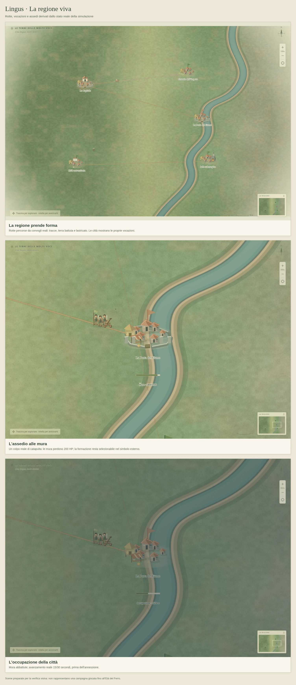

# La mappa regionale

Nei Tier 4 e 5 la regione mostra città, specializzazioni, convogli e assedi con una rappresentazione cartografica più leggibile. Questi segni seguono traffico, istituzioni e combattimenti effettivi.

Le immagini sono scene preparate: i convogli percorrono realmente le rotte e l'assedio usa il normale aggiornamento imperiale. Non dimostrano una campagna ordinaria partita da sette abitanti e arrivata all'Età del Ferro.

## Strade e memoria del traffico

Ogni spostamento di una carovana commerciale o fiscale registra soltanto il tratto percorso. La destinazione futura rimane priva di strada. Due visite disgiunte restano separate finché un convoglio non attraversa anche l'intervallo fra loro; soste, blocchi doganali e carovane distrutte non producono usura. Coloni e delegati non aggiungono traffico a questa rappresentazione.

Il primo passaggio lascia una traccia; circa due attraversamenti equivalenti producono terra battuta. Nel Tier 5, almeno quattro attraversamenti equivalenti mostrano un lastricato. La misura è distanza percorsa divisa per lunghezza del frammento: variazioni della dimensione del tick non accelerano la trasformazione. Su un tratto visitato solo in parte, l'usura rappresenta la media del traffico effettivo.

La storia è persistente e limitata a **2048 frammenti**, suddivisi dalle intersezioni con una griglia di 12,5 m. Raggiunto il limite, un nuovo tratto sostituisce quello con meno traffico accumulato. Il disegno scarta il fuori campo e conserva al massimo 4096 geometrie preparate in cache. Le strade si interrompono sul fiume disegnato: non viene inventato un ponte. La rappresentazione non modifica itinerari, velocità, costi o risorse.

## Città e vocazioni

La sagoma della città cresce con la popolazione reale. I simboli distinguono il Granaio dell'Impero, il Polo siderurgico, l'Emporio e la Città universitaria; una città può mostrare entrambe le proprie vocazioni.

Campi, granaio, fonderia, mercato, edificio culturale, palazzo e mura richiedono istituzioni effettivamente presenti e completate. Il titolo di capitale, da solo, non crea un palazzo. Mura inattive restano fisicamente presenti; i danni e il crollo ne cambiano il disegno. Campi e colture seguono la stagione. Fiamme e fumo delle fonderie richiedono lavoro e materiali disponibili; il fumo parte dal camino del simbolo urbano.

Le etichette mantengono dimensioni leggibili con lo zoom. La scheda del bersaglio spiega vocazione, attività e assedio; le quantità e i secondi esatti restano subordinati alla conoscenza di **Numero**.

## Assedio e occupazione

La barra delle mura usa gli HP reali. Quando le mura cadono, la guarnigione ancora presente ha uno stato distinto; soltanto un battaglione in conquista, vivo e alla distanza effettiva, mostra il proprio progresso di occupazione su **30 secondi**. Non vengono sommati i contatori di più eserciti né riutilizzato il contatore di una città dopo la ritirata.

Un proiettile compare soltanto dopo un colpo reale della catapulta contro una specifica cinta muraria. Il danno rimane quello del motore: 200 HP per colpo, limitato agli HP residui. Il breve arco è una rappresentazione del colpo già calcolato; cambiare bersaglio non lo dirige verso un'altra città. Il colpo finale rimane visibile anche dopo il crollo delle mura.

I simboli degli assedianti si dispongono fuori dalla sagoma urbana, collegati al punto reale. Il terreno di combattimento e la portata restano invariati. Disegno, selezione e catapulte condividono la stessa posizione cartografica; il clic restituisce il bersaglio con le coordinate della simulazione. Nomi, popolazione e barra hanno spazio riservato sotto la città.

Pausa e **Riduci movimento** sono rispettati: il primo ferma la rappresentazione del colpo, il secondo sostituisce il volo con un segno statico di impatto. Le sorgenti recenti hanno un limite di 64; gli elementi fuori visuale e quelli non visibili non vengono disegnati.

## Salvataggi e prove

La versione del salvataggio resta 2. I campi facoltativi `regionalRoutes` e `lastSiegeShot` conservano soltanto storia visiva ed ultimo impatto; i salvataggi precedenti continuano a caricarsi senza inventare viaggi passati. L'importazione controlla limiti, geometria finita, chiavi uniche, danno e data del colpo. Le osservazioni non consumano il generatore casuale.

`regionalHistory.test.ts`, `mapRouteArt.test.ts`, `cityPresentation.test.ts`, `mapSiegeArt.test.ts` e `regionalLayout.test.ts` verificano storia, integrità del salvataggio, vocazioni e assedi. `regional-map.spec.ts` esercita movimento reale, colpi, annessione dopo trenta secondi, tetti e simboli selezionabili in Chromium su desktop e mobile.

Verifica della revisione: **825 test del motore/componenti e 62 prove browser superati**, build TypeScript/Vite, formattazione e controllo del diff validi.

Una prova di carico preparata con 25 città e il limite di 2048 frammenti, senza folla o elementi naturali, ha registrato in Chromium headless a 1080 × 900 una mediana di circa 9 ms per il disegno completo al 100% e 3,8 ms al 300%, dopo il riscaldamento delle cache. Le sole strade richiedevano rispettivamente circa 3,9 e 0,6 ms; la prima preparazione delle geometrie al limite richiedeva circa 155 ms. La misura riguarda l'invio dei comandi al Canvas, con lettura di un pixel separata, e non garantisce lo stesso frame rate sui telefoni. Nessun errore JavaScript o mutazione dello stato durante il disegno.

Le campagne complete e le altre verifiche della guida rimangono distinte in [REMAINING.md](REMAINING.md).
