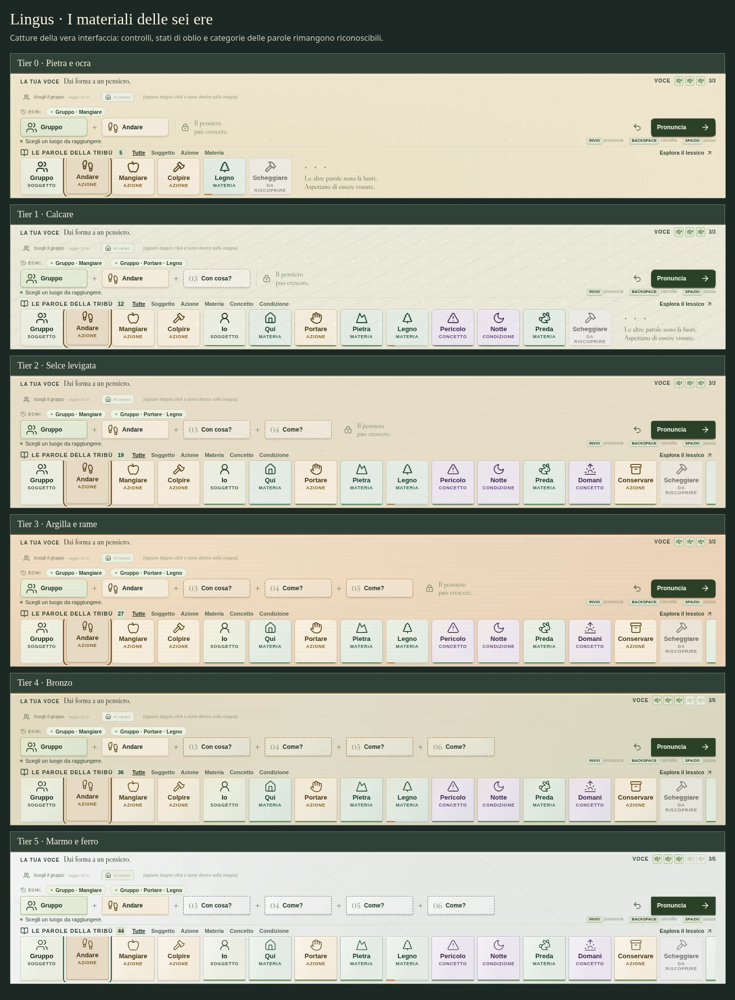
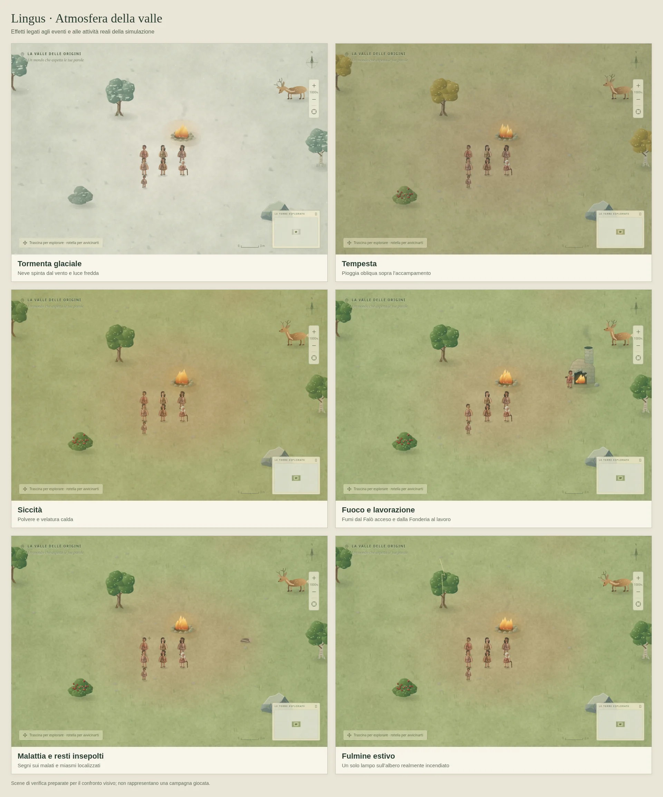

# Materiali delle ere e atmosfera della valle

L'interfaccia segue il Tier reale della comunità attraverso la classe `tier-0` … `tier-5` sul contenitore dell'applicazione. Cambiano pigmento, grana e cornici della Barra del Linguaggio, dei pannelli e delle finestre: pietra e ocra nelle prime tre ere, argilla e rame nel Neolitico, bronzo nel Tier 4, marmo e ferro inciso nel Tier 5. I glifi conservano il significato e la posizione dei comandi; etichette, focus da tastiera e stati di pericolo, fragilità, oblio e indisponibilità restano distinguibili.

Gli effetti atmosferici del Canvas dipendono dalle condizioni presenti nel salvataggio:

- La tormenta produce neve obliqua e una velatura fredda; la tempesta produce pioggia e una luce più cupa.
- La siccità aggiunge polvere e toni asciutti senza cambiare la geografia o la quantità dei giacimenti.
- Il fulmine ha un breve segno locale presso l'albero realmente incendiato. Il flag stagionale non genera una sequenza di lampi.
- Il Falò acceso emette fumo; la Fonderia richiede anche lavoro produttivo effettivo. Edifici spenti, distrutti o ancora in costruzione non emettono fumo.
- I resti umani insepolti hanno esalazioni leggere; il segnale di malattia richiede un'infezione ancora in corso. Le esalazioni indicano resti presenti, non certificano da sole un'epidemia.

Le sorgenti locali rispettano esplorazione e visuale. La nebbia non rivela incendi, fabbriche, malati o cadaveri nascosti. Il disegno usa tempo e coordinate della simulazione senza consumarne numeri casuali, modificare risorse o aggiungere campi ai salvataggi.

Gli effetti si fermano in pausa. La preferenza di sistema **Riduci movimento**, anche quando cambia a partita aperta, sostituisce le particelle animate con indicazioni statiche più sobrie. Non vengono usati flash bianchi a schermo intero. Il numero di particelle è limitato alla superficie visibile e le sorgenti fuori campo vengono scartate.

## Verifica

Gli otto casi in `mapAtmosphere.test.ts` esercitano condizioni attive e inattive, occultamento delle sorgenti fuori esplorazione, pausa, movimento ridotto, Fonderie individuali e urbane e limiti del numero di particelle. Le prove browser in `atmosphere.spec.ts` e `tier-materials.spec.ts` verificano anche i pixel effettivi del Canvas, il cambio della preferenza a partita aperta, l'uso dei controlli nelle sei ere e gli schermi stretti. Le scene illustrate preparano condizioni specifiche per valutarne il disegno; non rappresentano una campagna ordinaria attraverso tutte le ere.

Verifica della revisione: **802 test del motore/componenti e 58 prove browser superati**, build TypeScript/Vite e controllo della formattazione validi.

Una misura in Chromium headless a 1080 × 900, con 150 persone, 582 elementi e il limite di 32 sorgenti raggiunto, ha rilevato mediane di circa 10–22 ms per il disegno completo a zoom 100%, 580%, 1000% e 1600%. Pioggia e neve usavano rispettivamente 150 e 130 particelle; lo stato della simulazione è rimasto identico e non sono comparsi errori JavaScript. Sono tempi di invio del disegno al Canvas in una scena preparata, con cache già calde e lettura di un pixel separata dalla misura; non garantiscono lo stesso frame rate sui telefoni.

Questa revisione completa questi due interventi visivi. [REMAINING.md](REMAINING.md) mantiene separate le campagne e le altre verifiche ancora aperte.
