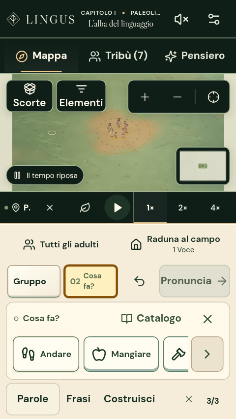
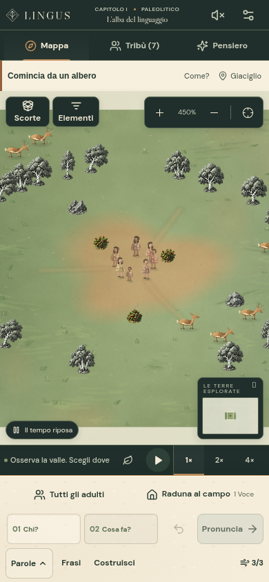
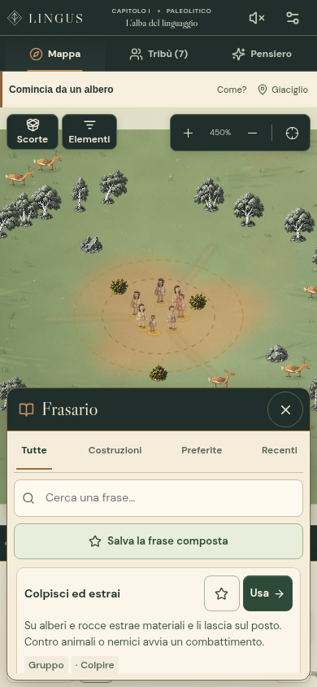

# Interfaccia 0.3.2 — pietra, avorio e rame

La schermata di gioco distingue ora tre livelli: la navigazione scura, il mondo
pittorico e il piano avorio su cui comporre gli ordini. Frasi e Costruisci restano
raggiungibili anche con la palette delle parole chiusa. La revisione riguarda la
presentazione; non modifica costi, formule, avanzamento o formato dei salvataggi.

## Gerarchia visiva

- Testata e navigazione condividono una superficie scura. La sezione attiva ha
  un accento di materiale e uno stato accessibile `aria-current`.
- Sul telefono la fascia del nome della valle lascia spazio alla mappa finché
  non contiene scorte o informazioni stagionali effettivamente conosciute.
- Scorte, Elementi, zoom e minimappa appartengono alla stessa famiglia di
  strumenti. I colori restano leggibili sullo sfondo variabile della valle.
- La frase è composta da tessere chiare con glifi, accenti semantici e uno
  stato di modifica evidente. I controlli di selezione e le scorciatoie hanno
  un peso minore rispetto a Pronuncia. Sui telefoni più stretti i glifi iniziali
  lasciano spazio alle etichette.
- Frasario, scorte, Falò e impostazioni condividono intestazioni scure e
  contenuti avorio. Le lezioni hanno testi e azioni leggibili anche sul desktop.

I pigmenti comuni sono in `InterfaceTheme.css`; geometria e stati restano nei
fogli dei rispettivi componenti. I sei materiali originali rimangono distinti:
gli accenti passano da ocra e selce a rame, bronzo e ferro. La famiglia tipografica
è ora `DM Sans Variable`, corrispondente al font già incluso nel progetto;
`--sans` e `--font-body` ne condividono la definizione. I titoli conservano Libre
Caslon Display. Non si caricano font da servizi esterni.

## Uso sul telefono

La palette quotidiana resta parte del layout. Il catalogo esteso e il frasario
si aprono su richiesta senza introdurre un fondale che intercetti la mappa.
Selezionare un bersaglio non aggiunge righe al compositore. Sono conservati i
controlli tattili, le preferenze di testo grande e contrasto elevato e il rispetto
di `prefers-reduced-motion` per il nuovo feedback delle tessere.

Sugli schermi fino a 360 × 650, aprire la palette compatta nasconde temporaneamente
il suggerimento iniziale ordinario. Chiudere le parole lo ripristina. Gli avvisi
urgenti e gli aiuti che il giocatore ha espanso restano visibili.

Nel confronto della stessa scena iniziale a 390 × 844, la mappa passa da
487 a 513 px di altezza; il compositore passa da 156 a 155 px. Il risultato
dipende dal contenuto visibile: avvisi, testo grande, tastiera e schermate corte
hanno adattamenti propri, senza nascondere le informazioni di rischio.

## Audit e regressioni

Sono state osservate le schermate di mappa, frase composta, palette, frasario,
costruzioni, Tribù, Pensiero, scorte, impostazioni e Falò a 390 × 844,
320 × 568 con testo grande e contrasto elevato, 844 × 390 e 1440 × 1050.
Gli stati preparati servono a esaminare l'interfaccia e non certificano una
campagna completa.

L'audit ha individuato e corretto due regressioni concrete: il messaggio di
selezione degli adulti si restringeva a metà schermo coprendo lo zoom; un vecchio
stile di contrasto elevato produceva testo chiaro su fondo chiaro nel pulsante
Concludi consiglio. Il primo è rilevato dal test del comando touch già esistente.
Il controllo del consiglio ora verifica anche un rapporto di contrasto di almeno
4,5:1 sui colori effettivamente calcolati, prima di concludere un consiglio reale.

Le verifiche conservano i limiti del compositore di 180 px in verticale e
140 px in orizzontale, lo spazio per la mappa e il controllo che i pulsanti
ricevano davvero il tocco. La revisione è verificata in Chromium, con le prove
del deploy e delle sei ere; resta utile un playtest su dispositivi fisici.

Risultati della revisione: 1.408 test in 108 file superati, 82 scenari browser
verificati tra suite del deploy, sei materiali e nuovi flussi a 320 px, build e
controllo della formattazione validi. Anche il test del pacchetto compilato sotto
`/Lingus/` passa, caricando gli asset reali e usando frasario, costruzioni e
compositore. Le modifiche finali agli schermi piccoli sono state ricontrollate
nei due gruppi di prove mobile; i campioni dei tocchi restano sul terreno,
evitando i pulsanti flottanti anche quando la mappa è molto bassa.
