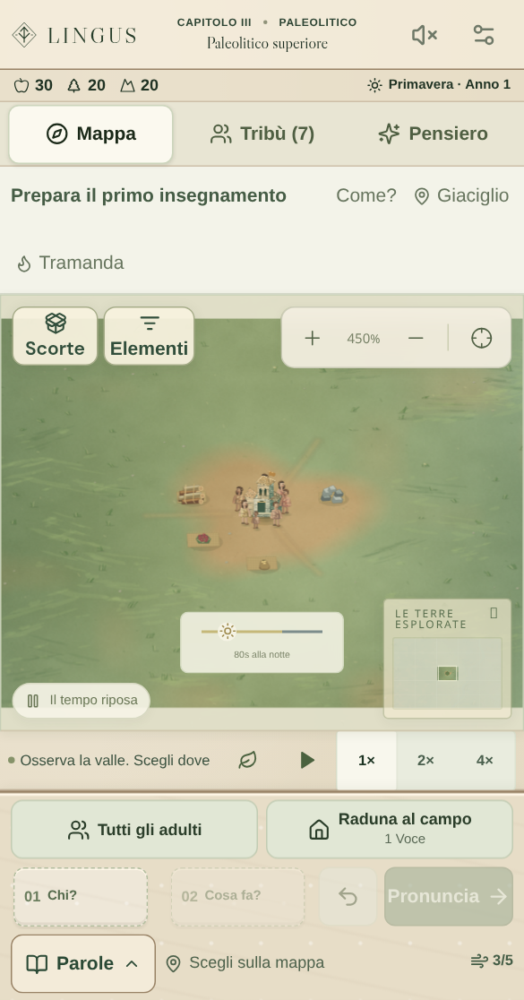

# Mappa: accessibilità, ridisegno e identità degli edifici

## Comportamenti verificati

- Il pulsante **Elementi** e il tasto **E**, quando la mappa ha il fuoco della tastiera, aprono un elenco ricercabile degli elementi inquadrati e rivelati. I bersagli si selezionano con i normali comandi di tastiera; l’ordine richiede ancora **Pronuncia**.
- Le descrizioni rispettano le conoscenze della tribù. Prima di **Io** non mostrano i nomi propri; prima della scoperta pertinente non rivelano il minerale. Un bersaglio mobile viene ricontrollato contro lo stato corrente prima della selezione e restituisce le coordinate effettive del motore.
- Sui telefoni, anche in una mappa alta soltanto 210 px, il pannello scorre insieme ai suoi risultati e mantiene bersagli di almeno 44 px. Non comprime la lista sotto ricerca e filtri.
- I controlli mobili occupano una sola riga: Scorte ed Elementi a sinistra, zoom e ritorno al campo a destra. Rimangono separati anche con testo grande, senza nascondere le etichette. Fino a 360 px la percentuale dello zoom resta disponibile alle tecnologie assistive, lasciando spazio ai pulsanti da 44 px.
- L’indicazione di pausa resta sul bordo inferiore, separata dalla barra del giorno e dalla minimappa. Sulle mappe molto corte dello schermo più stretto la minimappa si compatta e l’indicatore del giorno si allinea a sinistra, senza sovrapporsi. Gli indicatori non intercettano i tocchi destinati alla mappa.
- In pausa il Canvas si ridisegna soltanto per una modifica reale: stato, visuale, selezione, puntatore, dimensione, preferenza di movimento o completamento del caricamento dell’atlante. I test contano le chiamate di disegno per escludere un ciclo continuo.
- Una mappa nascosta o fuori schermo interrompe il disegno. Al ritorno riparte dall’istantanea corrente, senza ricostruire viaggi avvenuti mentre era nascosta. Il limite ordinario di 30 disegni al secondo resta invariato.
- Tempio, archivio, scuola, tribunale e palazzo hanno strutture distinte: scalinata e portico; deposito chiuso e tavolette; tettoia e banchi; corte e seggio; ali e torre. Non sono aggiunti abitanti o attività inesistenti per decorazione.

## Verifica eseguita

Il gruppo di verifica browser comprende 20 casi distinti in Chromium:

```sh
npx playwright test tests/accessible-world.spec.ts tests/motion-selection.spec.ts tests/atmosphere.spec.ts tests/visual-map.spec.ts tests/art-direction.spec.ts --workers=2
```

I primi 19 casi sono passati insieme; dopo la correzione del pannello mobile sono ripassati tutti e cinque i casi di `accessible-world.spec.ts`, incluso il ventesimo caso nuovo. Sono passati anche i sette test unitari di `visibleWorldTargets.test.ts`.

Sono state osservate le immagini prodotte dal renderer effettivo: tutte le venti costruzioni, vista regionale, campo su telefono da 390 px e interfaccia completa nello spazio di gioco mobile. Non sono emersi tagli delle nuove sagome o spostamenti dei bersagli. Le scene artistiche sono preparate e verificano disegno e interazione, non il raggiungimento di quei contenuti durante una campagna.

## Revisione successiva dei controlli mobili

La prima esecuzione complessiva aveva superato 162 casi su 165. Due regressioni riguardavano il nuovo pulsante Elementi, che copriva una zona utile della mappa durante la composizione; il terzo caso aveva una scorta alimentare preparata superiore alla capienza e un’aspettativa precedente alla cottura continuativa. La disposizione dei controlli e la fixture sono state corrette, mantenendo le verifiche dei tocchi reali sul Canvas.

Il gruppo mirato successivo è passato interamente: **34 casi** fra composizione mobile, qualità della vita, preferenze e accessibilità della mappa.

```sh
npx playwright test tests/mobile-composer-flow.spec.ts tests/quality-of-life.spec.ts tests/consolidation-settings.spec.ts tests/accessible-world.spec.ts --workers=2
```

I tre casi dedicati ai controlli usano il testo grande a **320 × 568**, **390 × 744** e **844 × 390**. Verificano aree di tocco di almeno 44 px, etichette da almeno 14 px senza tagli, controlli separati e aperture effettive di Scorte ed Elementi senza spendere Voce. L’ispezione delle immagini ha individuato anche un’intersezione fra barra del giorno e minimappa nello schermo più stretto: dopo la correzione sono ripassati tutti e tre i casi, aggiungendo i confronti fra questi indicatori e i limiti del Canvas.

```sh
npx playwright test tests/mobile-composer-flow.spec.ts --grep 'map tools form' --workers=1
```

Sono state osservate nuovamente le tre immagini finali: etichette, pausa, giorno, minimappa e controlli sono distinti e contenuti nello spazio di gioco. Questi controlli mirati non sono presentati come una nuova esecuzione completa di tutte le suite.



Queste verifiche coprono la correttezza dello scheduler e le interazioni del browser; non sono una misura di FPS o consumo energetico su telefoni fisici, né una certificazione completa di accessibilità con lettore di schermo. Rimane necessaria una sessione su hardware reale per tali valutazioni.
